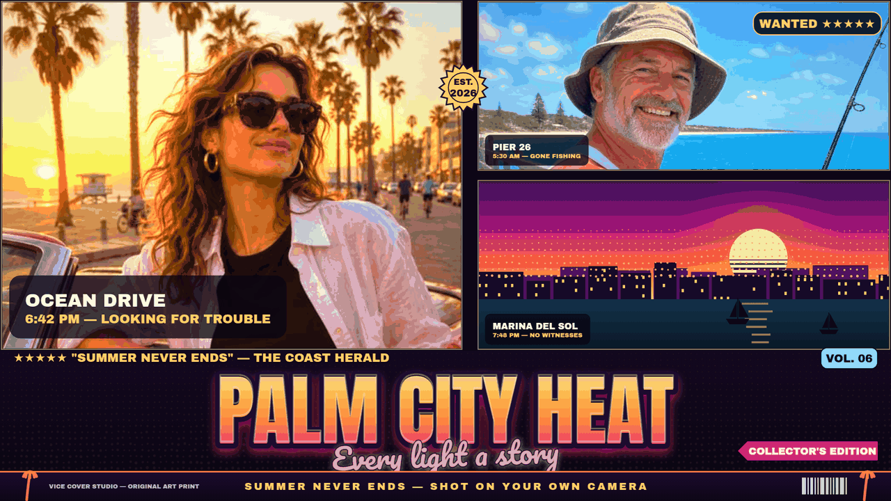

[](https://make.fun/bounty/gta6-cover-art-01)
[](https://make.fun/bounty/gta6-cover-art-01)
[](https://make.fun/bounty/gta6-cover-art-01)

# Palm City Heat — multi-panel cover maker

A free offline browser app that turns any photo into a neon-sunset
multi-panel cover poster: a vivid hero panel, labelled story panels, a
procedurally drawn marina scene, gradient display lettering, and
one-click PNG export at landscape, portrait, and square sizes.



## The champion cover

**PALM CITY HEAT** — three-panel Vice Hero layout, Vivid Sunset grade,
seed 42:

- **Hero** — the boulevard photo, large and vivid, labelled
  OCEAN DRIVE / 6:42 PM — LOOKING FOR TROUBLE
- **Pier** — the pier photo, labelled PIER 26 / 5:30 AM — GONE FISHING
- **Marina** — a canvas-drawn scene (seeded skyline, slatted sun,
  water with a gold reflection, two sailboats), labelled
  MARINA DEL SOL / 7:48 PM — NO WITNESSES
- **Lettering** — gradient title with a dark outline and pink script
  subtitle "Every light a story", the quote
  ★★★★★ "SUMMER NEVER ENDS" — THE COAST HERALD, WANTED ★★★★★ pill,
  EST. 2026 starburst seal, VOL. 06 chip, COLLECTOR'S EDITION ribbon,
  and a bottom strip with palm silhouettes, tagline, fine print, and
  a barcode.

## Use it

```sh
node serve.ts        # then open http://localhost:8080
```

1. Load the two sample photos (or upload up to 3 of your own).
2. Pick a layout (Vice Hero + Story, Single Hero, Duo Split,
   Filmstrip, Four Corners, Three Columns) and a grade (Vivid Sunset,
   Duotone Dusk, Halftone Pop, Clean Coast, Grain Reel).
3. Type your title, kicker, script subtitle, and strip tagline; set a
   seed or hit Surprise me.
4. Fine-tune each photo's crop (zoom / pan) per panel.
5. Export the current size, or all three sizes at once.

Every photo is cropped around its face anchor, so heads stay fully
visible at every export size. The preview and the export are painted
by the same compositor, so what you see is what the PNG holds. The
editor also runs headless: `window.__renderExport(w, h)` returns the
current cover as a PNG data URL at any size.

## Layouts and grades

| Layout | Panels |
|---|---|
| Vice Hero + Story | hero + pier + drawn marina scene |
| Single Hero | one full-width hero |
| Duo Split | two side-by-side photos |
| Filmstrip | hero + three stacked panels |
| Four Corners | two photos + marina + skyline |
| Three Columns | three vertical panels |

Grades change the sky palette, the sun, the skyline, and the photo
treatment (vivid saturation, duotone, halftone dots, clean, grain).

## Files

- `app/index.html` — editor shell
- `app/style.css` — dark neon editorial theme
- `app/src/presets.js` — grades, layouts, sizes, default state
- `app/src/cover.js` — the compositor (panels, treatments, title band)
- `app/src/lettering.js` — title, script, labels, badges, strip
- `app/src/skyline.js` — seeded skyline backdrop + marina scene
- `app/src/halftone.js` — seeded RNG, halftone dots, grain
- `app/src/shots.js` — deterministic screenshot scenes
- `app/src/main.js` — editor wiring + headless export hook
- `app/fonts/` — Anton, Archivo Black, Pacifico (SIL OFL, texts beside
  each font; fetched from the google/fonts repository)
- `app/samples/` — the kit's two sample photos (boulevard, pier)
- `main.ts` — builds the entry (copies `app/` + `screenshots/`,
  writes `dossier.json`)
- `serve.ts` — tiny static server for local use
- `shots.json` — the four deterministic screenshot scenes
- `vendor/makefun-app.ts` — the kit's dossier builder, unchanged

## Determinism

Same state + same seed = same cover, byte for byte. The shot scenes in
`shots.json` load the fonts explicitly before measuring or drawing, so
renders are identical on every run.

## License

MIT — see [LICENSE](LICENSE). Fonts are under the SIL Open Font License
1.1 (see `app/fonts/*-OFL.txt`). Sample photos were made for make.fun
and are free to use.
